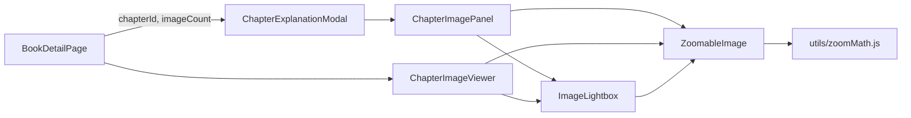

# 章节图片：边读边看 + 放大查看

状态：已实现（待手动验收，见第 9 节）
范围：仅前端（`frontend/`），后端与数据库不改动，不新增 npm 依赖

---

## 1. 问题

1. **阅读 explanation 时无法同时查看章节图片。** 打开图片要先关掉阅读器，看完再重新打开阅读器，阅读位置和上下文都会被打断。
2. **章节图片不能放大。** 图片被限制在 `max-height: 60vh` 内按比例缩小，截图、图表、手写笔记等细节看不清。

## 2. 根因

| 问题 | 位置 | 说明 |
| --- | --- | --- |
| 1 | [BookDetailPage.jsx](../../../frontend/src/pages/BookDetailPage.jsx) 中 `imageViewer` 与 `reader.modal` | 两者都是全屏遮罩弹窗：`ChapterImageViewer` 是 `createPortal` 的 `.chapter-image-overlay`（`z-index: 9999`），`ChapterExplanationModal` 基于 `Modal`（`.modal-overlay`，`z-index: 100`）。同时打开时互相遮挡，焦点和键盘事件也会冲突。 |
| 1 | [ChapterExplanationModal.jsx](../../../frontend/src/components/ChapterExplanationModal.jsx) | 阅读器拿不到 `chapterId`，也没有任何与图片相关的 UI。 |
| 2 | [ChapterImageViewer.jsx](../../../frontend/src/components/ChapterImageViewer.jsx) 浏览模式 | 只渲染一个普通 ``，CSS（[image-viewer.css](../../../frontend/src/styles/image-viewer.css)）为 `max-width: 100%; max-height: 60vh; object-fit: contain`，没有缩放和平移逻辑。 |

## 3. 方案概览

1. **阅读器内嵌“图片侧栏”（分栏布局）。** 在 explanation 阅读器里加一个可开关的右侧图片面板，左边是正文，右边是图片，中间的分隔条可以拖动调整宽度。阅读模式、编辑模式、全屏模式下都能用。
2. **新增可复用的 `ZoomableImage` 组件。** 用 CSS `transform` 自己实现缩放和平移，不引入第三方库。支持滚轮缩放、拖动、双击、按钮、键盘和双指缩放。在侧栏和原有的 `ChapterImageViewer` 里共用。
3. **新增 `ImageLightbox` 全屏灯箱。** 从侧栏或 `ChapterImageViewer` 点 ⛶，把当前图片铺满屏幕查看（同样可以缩放），关闭后回到原处。

职责划分：上传和删除仍然只在 `ChapterImageViewer` 里做；阅读器侧栏是**只读浏览**。

## 4. 交互设计

### 4.1 阅读器图片侧栏

- **入口**：在 `ExplanationFooter` 中“Fullscreen”按钮之后加一个切换按钮 `🖼 Images (N)`，阅读模式和编辑模式都显示。
  - 只在 `imageCount > 0` 时显示；`imageCount` 取自 `chapter.imageCount`，由 `BookDetailPage` 传入，不需要额外请求。
  - 打开时按钮带 `aria-pressed="true"`，文字为 `🖼 Hide Images`。
- **布局（宽屏，视口宽度 ≥ 900px）**：
  - 阅读器主体变为横向分栏：`[正文列 | 分隔条 | 图片面板]`。
  - 图片面板默认占 40% 宽度，可拖动范围为 25%–65%。
  - 侧栏打开且不在全屏时，弹窗 `max-width` 从 1100px 放宽到 `min(1600px, 96vw)`（给 modal 加一个 class，例如 `has-image-panel`）。
  - 全屏模式下正文列的 `max-width: 1600px` 居中规则只作用于正文列本身，不能把图片面板挤出视口。
- **布局（窄屏，< 900px）**：上下排列，图片面板在上，高度 40vh，不显示拖动分隔条。
- **分隔条**：`role="separator"`、`aria-orientation="vertical"`、`tabIndex=0`；用 Pointer Events 拖动（`setPointerCapture`）；获得焦点时用 ←/→ 每次调整 5%。
- **图片面板内容**（从上到下）：
  1. 顶部工具行：`‹`、`n / N`、`›`、图片文件名（单行省略），右侧放 ⛶（在灯箱中打开）。
  2. 主体：`ZoomableImage`，占满剩余高度，自带缩放工具条（见 4.2）。
  3. 底部缩略图条：横向滚动，当前图片高亮；`` 直接用 `chapterImageApi.getUrl`（后端没有缩略图接口，本次不加）。
- **状态与持久化**（扩展 `useReaderPreferences`，沿用它的 localStorage 写法）：
  - `explanationReaderImagePanel`：`'on' | 'off'`，默认 `'off'`。
  - `explanationReaderImagePanelRatio`：数字 0.25–0.65，默认 0.4，读取时 clamp。
  - 当前图片下标不持久化，换章节或重新打开时从第 1 张开始。
- **加载/空/错误态**：面板打开后才调用 `useChapterImages(chapterId)`，与 `ChapterImageViewer` 共用缓存；加载中显示 `Loading...`，出错复用 `LoadError`，列表为空时显示 “No images”。
- **与现有阅读器功能的兼容（重要）**：
  - `bodyRef` 必须仍然指向**正文的滚动容器**。`useReadingPosition`（滚动恢复 / 跳转到段落）、`handleBookmark`（scrollRatio）、`useFloatingMenu`（段落菜单定位）都依赖它，图片面板不能放进 `bodyRef` 内部。
  - 选中段落保存（`usePassageMarks`）只作用于 `contentRef`，图片面板在它之外，不会受影响。
  - 打开或关闭侧栏会改变正文宽度，导致重新排版，但不应重置滚动位置，也不应触发 `useReadingPosition` 的初始定位。实现后需要手动确认。

### 4.2 `ZoomableImage` 缩放行为

缩放比例 `scale` 以图片**原始像素**为基准，100% 即原图 1:1。

| 操作 | 行为 |
| --- | --- |
| 初次加载 / 切换图片 / 容器尺寸变化（且处于适应模式） | “适应窗口”：`fitScale = min(容器宽/原图宽, 容器高/原图高, 1)`，图片居中。小图不放大。 |
| 鼠标滚轮 | 以鼠标指针为中心缩放，每格约 ×1.2 / ÷1.2。必须阻止页面或正文滚动。 |
| 拖动（鼠标 / 单指） | 平移；光标为 `grab` / `grabbing`。 |
| 双击 | 在“适应窗口”和 100% 之间切换，以双击位置为中心。 |
| 双指捏合（触屏） | 以两指中点为中心缩放。 |
| 工具条按钮 | `−`、`当前百分比`（只显示）、`+`、`适应`、`1:1`、可选的 `⛶`（`onExpand` 存在时显示）。 |
| 键盘（容器 `tabIndex=0`，**只在获得焦点时**生效） | `+` / `=` 放大，`-` 缩小，`0` 适应窗口，`1` 原图 1:1。 |

- 缩放范围：`[min(fitScale, 0.1), 8]`，即最小不低于 10% 或适应比例中更小的那个，最大 800%。
- 平移边界：图片在某个方向上小于容器时，该方向居中；大于容器时，不允许拖出空白（图片边缘最多贴到容器边缘）。
- 切换图片时重置为适应窗口：在调用处用 `key={image.id}` 重新挂载组件即可。

### 4.3 `ImageLightbox` 全屏灯箱

- `createPortal` 到 `document.body`，`z-index: 10000`，高于 `.chapter-image-overlay`（9999）和 `.modal-overlay`（100）。
- 内容：铺满屏幕的 `ZoomableImage`，加上 `‹ n / N ›`、文件名和 ✕。点击背景（非图片区域）关闭。
- 键盘：Esc 关闭，←/→ 切换图片，`+ - 0 1` 转发给缩放。

### 4.4 键盘与 Esc 优先级（重点）

当前情况：

- `Modal` 在 `document` 上用**冒泡阶段**监听 Esc 来关闭阅读器。
- 阅读器全屏时，在 `document` 上用**捕获阶段**监听 Esc 并 `stopPropagation()` 来退出全屏。
- `ChapterImageViewer` 在 `document` 上用冒泡阶段监听 Esc / 方向键。

要求的 Esc 优先级：**灯箱 > 阅读器全屏 > 关闭阅读器**。

- 灯箱的 keydown 监听必须注册在 **`window` 的捕获阶段**，并调用 `e.stopPropagation()`。
  - 原因：同一节点（`document`）上的捕获监听器按注册顺序执行，`stopPropagation` 拦不住同一节点上的其他监听器。而 `window` 捕获阶段在 `document` 之前执行，能保证灯箱先处理，并阻止事件继续传到 `document`。
  - 灯箱处理的所有按键（Esc、←、→、+、-、0、1）都要 `stopPropagation`，这样它下面的 `ChapterImageViewer` 也不会跟着切图。
- 图片侧栏的 ←/→ 切图**不能**挂在 `document` 上，否则会和正文阅读冲突。只在面板根元素上用 `onKeyDown` 处理，也就是焦点在面板内时才生效。
- `ChapterImageViewer` 自己的 document 级方向键处理保持不变（它是独占弹窗，没有冲突）；它的 `useEffect` 应在灯箱打开时跳过，做法和现有的 `confirmDelete` 分支一样。

### 4.5 `ChapterImageViewer` 的调整

- 浏览模式下把 `` 换成 `<ZoomableImage key={currentImage.id} … onExpand={() => setLightbox(true)} />`。
- `.chapter-image-main` 需要一个确定的高度（例如 `height: 60vh`），缩放容器才有尺寸可用；`.chapter-image-img` 的样式不再需要。
- 删除按钮、文件名、上一张/下一张导航保持不变。

## 5. 文件清单

### 新增

| 文件 | 内容 |
| --- | --- |
| `frontend/src/utils/zoomMath.js` | 纯函数：`fitScale(natural, container)`、`clampScale(s, min, max)`、`zoomAt({scale, x, y}, nextScale, point)`（以 point 为中心缩放：`x' = px - (px - x) * next/scale`）、`clampOffset({scale, x, y}, natural, container)`。不依赖 DOM，便于单元测试。 |
| `frontend/src/utils/zoomMath.test.js` | 上述函数的单元测试。 |
| `frontend/src/components/images/ZoomableImage.jsx` | 4.2 的实现。 |
| `frontend/src/components/images/ZoomableImage.test.jsx` | 组件测试。 |
| `frontend/src/components/images/ImageLightbox.jsx` | 4.3 的实现。props：`images`、`index`、`getUrl(image)`、`onIndexChange`、`onClose`。 |
| `frontend/src/components/images/ImageLightbox.test.jsx` | 组件测试。 |
| `frontend/src/components/explanation/ChapterImagePanel.jsx` | 4.1 的面板（不含分隔条）。props：`chapterId`；内部调用 `useChapterImages`，管理当前下标和灯箱开关。 |
| `frontend/src/styles/zoomable-image.css` | `ZoomableImage`、灯箱、图片面板、分隔条的样式。按现有 styles 的引入方式接入（查看 `index.css` / `main.jsx` 里其他 css 是怎么引入的）。 |

### 修改

| 文件 | 改动 |
| --- | --- |
| `frontend/src/pages/BookDetailPage.jsx` | 给 `ChapterExplanationModal` 传 `chapterId={reader.modal.chapterId}` 和 `imageCount={chapterById(reader.modal.chapterId)?.imageCount ?? 0}`。 |
| `frontend/src/components/ChapterExplanationModal.jsx` | 接收 `chapterId`、`imageCount`；用 `.reader-split` 包住 `bodyRef` 所在的 div、分隔条和 `ChapterImagePanel`；把开关和比例交给 `prefs`；侧栏打开时给 modal 加 `has-image-panel` class。 |
| `frontend/src/components/explanation/ExplanationFooter.jsx` | 新增 props `imageCount`、`imagePanelOpen`、`onToggleImagePanel`；阅读和编辑两种模式都渲染切换按钮。 |
| `frontend/src/components/explanation/useReaderPreferences.js` | 新增 `imagePanelOpen`、`toggleImagePanel`、`imagePanelRatio`、`setImagePanelRatio`（clamp 0.25–0.65），并持久化。 |
| `frontend/src/components/ChapterImageViewer.jsx` | 见 4.5。 |
| `frontend/src/styles/reader-modal.css` | 加 `.reader-split`、`.review-reader-modal.has-image-panel` 宽度规则、全屏下的分栏规则，以及 `@media (max-width: 899px)` 的上下布局。 |
| `frontend/src/styles/image-viewer.css` | 调整 `.chapter-image-main`，移除不再使用的 `.chapter-image-img`。 |

## 6. 实现要点与坑

1. **滚轮事件不能用 React 的 `onWheel`**。React 把 wheel 监听注册成 passive，`preventDefault()` 无效，页面或正文会跟着滚。要在 `useEffect` 里 `el.addEventListener('wheel', handler, { passive: false })`，并在清理函数里移除。
2. **容器尺寸**：用 `ResizeObserver` 监听容器大小（分隔条拖动、全屏切换、窗口缩放都会改变尺寸）。处于“适应”模式时自动重新计算 `fitScale`；用户手动缩放后，只重新做平移边界 clamp，不重置缩放。jsdom 没有 `ResizeObserver`，组件里要判断 `typeof ResizeObserver !== 'undefined'`，测试里也可以用 `vi.stubGlobal` 打桩。
3. **原图尺寸**：在 `` 中读取 `naturalWidth` / `naturalHeight`，读到之前不渲染 transform（或先隐藏图片）。
4. **transform 写法**：`transform: translate(${x}px, ${y}px) scale(${scale})`，`transform-origin: 0 0`。图片设置 `max-width: none`、`draggable={false}`、`user-select: none`；容器设置 `overflow: hidden`、`touch-action: none`。
5. **双指缩放**：用一个 `Map<pointerId, {x, y}>` 记录活动指针。两指时根据距离比例和中点调用 `zoomAt`；一指时平移。`pointerup` / `pointercancel` 时从 Map 中删除。
6. **区分拖动和点击**：灯箱“点击背景关闭”时，如果指针移动超过约 4px，就当作拖动，不关闭。
7. **状态更新**：缩放和平移状态放在一个 `useState({scale, x, y, fit: boolean})` 里，避免多个 state 不同步。拖动时可以用 `requestAnimationFrame` 合并更新，但不是必须的。
8. **不要改动**现有 `Modal` 组件的 Esc 逻辑，优先级问题完全在灯箱这一侧解决（见 4.4）。
9. 遵守仓库现有约定：注释只写代码本身表达不了的内容，保持简短；`npm run lint` 要求 0 warning。

## 7. 实现步骤（建议顺序）

1. `zoomMath.js` 和单元测试。
2. `ZoomableImage` 和测试；先替换到 `ChapterImageViewer` 里，验证第二个问题已解决。
3. `ImageLightbox` 和测试；在 `ChapterImageViewer` 里接入 ⛶。
4. 扩展 `useReaderPreferences`。
5. `ChapterImagePanel`，以及 `ChapterExplanationModal`、`ExplanationFooter` 的分栏和切换按钮；在 `BookDetailPage` 里传入 props。
6. 分隔条拖动和窄屏布局。
7. 跑 `npm run lint` 和 `npm test`，再手动验收（第 9 节）。

## 8. 自动化测试清单

- **`zoomMath.test.js`**
  - `fitScale`：大图被缩小；小图保持为 1。
  - `clampScale`：上下限生效。
  - `zoomAt`：缩放中心点在屏幕上的位置不变。
  - `clampOffset`：小于容器时居中；大于容器时不能拖出空白。
- **`ZoomableImage.test.jsx`**（通过 `Object.defineProperty` 模拟 `naturalWidth` / `naturalHeight` 和容器的 `clientWidth` / `clientHeight`，然后触发 `load`）
  - 点 `+` 后百分比变大，点 `−` 后变小，到上下限时按钮 disabled。
  - 点 `1:1` 显示 `100%`；点 `适应` 回到适应比例。
  - 焦点在容器上时，按键 `0` / `1` / `+` / `-` 生效；焦点不在容器上时，`document` 上的按键不生效。
  - 双击在适应比例和 100% 之间切换。
- **`ImageLightbox.test.jsx`**
  - Esc 调用 `onClose`，并且外层监听在 `document` 上的 Esc handler **不会**被调用。
  - ←/→ 调用 `onIndexChange`，首张和末张有边界。
- **`ChapterExplanationModal.test.jsx`**（打开侧栏的用例需要用 `QueryClientProvider` 包裹，并 mock `../api` 的 `chapterImageApi`，写法参考 `ChapterImageViewer.test.jsx`）
  - `imageCount=0` 时没有 Images 按钮；`imageCount>0` 时有。
  - 点按钮后渲染图片面板并加载图片；再点一次关闭。
  - 开关状态写入 localStorage，重新渲染后保持。
  - 侧栏打开时，在正文中选中文字仍会出现段落菜单（防回归）。
  - 灯箱打开时按 Esc 只关灯箱，`onClose` 不被调用；全屏 + 灯箱时按 Esc，全屏状态保持。
  - 编辑模式下也能打开侧栏。
- **`ChapterImageViewer.test.jsx`**：现有用例全部通过；新增一条“浏览模式渲染缩放工具条”。

## 9. 验收标准（手动）

1. 打开有图片的章节 explanation，点 `🖼 Images (N)`，右侧出现图片，左侧正文可以正常滚动、选中文字、保存段落、加书签。
2. 拖动分隔条可以调整宽度；关闭再打开阅读器后，侧栏开关状态和宽度都保持。
3. 全屏阅读模式下侧栏正常；窗口变窄到 900px 以下时变成上下布局。
4. 在图片上滚动滚轮会以指针为中心缩放，正文不跟着滚；放大后可以拖动；双击在适应和 1:1 之间切换；工具条按钮和百分比显示正确。
5. 在图片面板里按 ←/→ 切图；焦点在正文时按 ←/→ 不切图。
6. 点 ⛶ 打开全屏灯箱并可以缩放。Esc 依次关闭：灯箱 → 阅读器全屏 → 阅读器。
7. 在原来的“章节图片”弹窗中，图片也能缩放并在灯箱中打开；上传、删除、上一张/下一张功能都不受影响。
8. 没有图片的章节不显示 Images 按钮，阅读器布局与现在完全一致。
9. 切换浅色和深色主题后，侧栏、工具条、灯箱的颜色都正常（使用现有 CSS 变量，例如 `--bg-card`、`--border`、`--text-secondary`、`--accent`）。

## 10. 不在本次范围

- 后端缩略图接口和图片压缩。
- 在侧栏中上传、删除或排序图片。
- 在 explanation 正文中插入或引用某张章节图片（例如点击正文中的标记跳到对应图片），可以作为后续需求。
- 把图片面板拆到独立的浏览器窗口。
