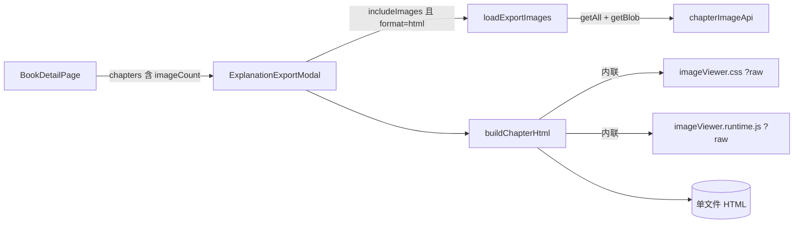

# 导出 Explanation 时带上章节图片：在导出的 HTML 里边读边看

状态：已实现，待按第 10 节在真机上手动验收（自动化测试、lint、生产构建均已通过）
范围：仅前端（`frontend/`）；后端、数据库不改；不新增 npm 依赖
相关：[chapter-image-reading-and-zoom](../chapter-image-reading-and-zoom/README.md)（应用内阅读器的图片侧栏和缩放，已实现。本方案在导出的 HTML 里复刻同样的体验）

---

## 1. 问题

“📄 Export Explanations” 导出的 HTML 只有 explanation 正文。章节图片（`chapter_image`，通过 `/api/chapters/{id}/images/{imageId}/data` 访问）完全没有导出，所以离线阅读导出文件时看不到这些图片，更没法边读边看。

## 2. 现状与根因

| 位置 | 说明 |
| --- | --- |
| [ExplanationExportModal.jsx](../../../frontend/src/components/ExplanationExportModal.jsx) `handleExport` | 每个章节只调用 `fetchContent(chapter.id)` 拿正文，从不请求图片。 |
| 同文件 `buildChapterHtml` | 生成的单文件 HTML 只有封面、正文和目录抽屉（TOC），没有任何与图片相关的结构、样式或脚本。 |
| [explanationExport.js](../../../frontend/src/pages/bookDetail/explanationExport.js) `explanationExportChapters` | 输出对象里没有 `imageCount`，弹窗无法知道哪些章节有图片。 |
| 图片与正文的关系 | 图片**不在** explanation 正文 HTML 里，而是挂在章节上的独立列表。这和应用内的设计一致：图片放在侧栏，不插进正文。 |

实测数据：单个章节最多 17 张图片，共约 5MB，平均每张约 300KB，最大约 730KB。后端只允许 PNG、JPEG、GIF、WEBP 四种格式（见 `ImageType`）。

## 3. 已确认的决策

| # | 决策 | 结论 |
| --- | --- | --- |
| D1 | 图片打包方式 | **base64 内嵌**到 HTML，导出的仍然是一个独立的单文件。多章节导出时仍然是“一个 zip 里放多个 html”，图片不单独成文件。 |
| D2 | 导出 HTML 里怎么看图 | **图片侧栏 + 全屏灯箱**，侧栏和灯箱都支持缩放和平移。 |
| D3 | 侧栏默认状态 | **默认收起**，通过悬浮按钮 `🖼 N` 打开。 |
| D4 | 主要阅读设备 | **手机和平板**，以触屏为先：双指缩放、拖动、滑动切图、双击。桌面浏览器也要能用（滚轮、键盘）。 |
| D5 | PDF（print）格式 | **不包含图片**，保持现状，也不请求图片。 |
| D6 | 导出选项 | 导出弹窗新增 “Include images” 勾选项，**默认勾选**。 |

## 4. 方案概览



1. **导出时**（React 侧）：对有图片的章节，先拉取图片列表，再逐张下载并转成 `data:` URL，交给 `buildChapterHtml`。
2. **生成的 HTML**：在正文之后加一段“图片数据区”（同时用作无 JS 时的后备画廊），再内联一段**原生 JS 运行时**（不依赖 React），负责悬浮按钮、侧栏或底部面板、缩放舞台和灯箱。
3. **没有图片的章节**，以及取消勾选 “Include images” 时，生成的 HTML 和现在**完全一致**，防止回归。

## 5. 导出端改动（React 侧）

### 5.1 代码重构：把 HTML 生成逻辑移出弹窗

[ExplanationExportModal.jsx](../../../frontend/src/components/ExplanationExportModal.jsx) 已经约 20KB，再加图片逻辑会难以维护和测试。先做一次**纯搬移**（行为不变）：

| 新文件 | 从弹窗移入的内容 |
| --- | --- |
| `frontend/src/utils/exportHtml/buildChapterHtml.js` | `buildChapterHtml`、`stripLinks`、`isRemovableLink`、`injectHeadingAnchors`、`renderTocTree`、`escapeHtml`、`formatDate`。`buildChapterHtml` 用具名导出。 |

`sanitize`、`chapterFileBase`、`downloadHtml`、`downloadBlob` 只和下载有关，继续留在弹窗里。搬完后先跑现有测试，确认全部通过，再开始下面的改动。

### 5.2 `explanationExportChapters` 带上 `imageCount`

[explanationExport.js](../../../frontend/src/pages/bookDetail/explanationExport.js) 的 `map` 里增加 `imageCount: o.chapter.imageCount ?? 0`。

### 5.3 API：下载图片二进制

在 [api.js](../../../frontend/src/api.js) 的 `chapterImageApi` 中新增：

```js
getBlob: (chapterId, imageId, opts) =>
  request(`/chapters/${chapterId}/images/${imageId}/data`, opts).then(res => res.blob()),
```

走 `request`，这样可以沿用统一的错误信息和 `error.status`。在 `api.test.js` 中补一条用例，验证 URL 和方法。

### 5.4 `loadExportImages`

新文件 `frontend/src/utils/exportHtml/exportImages.js`：

```js
// Returns { images: [{ name, dataUrl }], failed: number }
export async function loadExportImages(chapterId, expectedCount, api = chapterImageApi)
```

- 先调用 `api.getAll(chapterId)`，**保持后端返回的顺序**（和应用内侧栏一致）。
- 逐张调用 `api.getBlob`，并发上限为 3（可以写一个简单的 worker 池，也可以串行，都可以接受）。
- 用 `FileReader.readAsDataURL` 把 blob 转成 data URL。
- **白名单**：只接受 `blob.type` 为 `image/png`、`image/jpeg`、`image/gif`、`image/webp` 的图片，其余跳过并计入 `failed`。这是第二道防线，后端本来就只存这四种格式。
- 单张下载失败时计入 `failed`，不中断导出。`getAll` 本身失败时返回 `{ images: [], failed: expectedCount }`，同样不中断。
- `name` 取 `originalName`，为空时用 `Image ${i + 1}`。

### 5.5 `ExplanationExportModal` 的改动

- 新增 state `includeImages`，默认 `true`。
- 在 “No links” 旁边渲染勾选项 `Include images`，**只在** `format === 'html'` 且已选章节中至少有一章 `imageCount > 0` 时显示。`title` 写成 “Embed chapter images in the exported files (makes them larger)”。
- 每个章节的流程：
  ```text
  data   = await fetchContent(id)
  images = (format === 'html' && includeImages && chapter.imageCount > 0)
             ? await loadExportImages(id, chapter.imageCount) : { images: [], failed: 0 }
  html   = buildChapterHtml({ ..., images: images.images })
  ```
  所有章节累加 `failed`。导出结束后，如果 `failed > 0`，调用 `showToast(\`${failed} image(s) couldn't be included in the export.\`)`，这时文件**仍然照常导出**。
- PDF 格式**不请求**图片（D5）。
- 按钮上显示进度：导出过程中显示 `Exporting 2/5…`（第几个章节 / 共几个章节）。带图片的导出明显更慢，进度能让人知道还在运行。
- 内存：保持现在“处理一章、写入 zip、再处理下一章”的顺序，不要先把所有章节的图片一起加载到内存。

### 5.6 `buildChapterHtml` 的新参数

`buildChapterHtml({ ..., images = [] })`。当 `images.length === 0` 时输出与现在完全相同（第 4 节第 3 点）。当 `images.length > 0` 时：

- `<html lang="en" class="no-js has-images">`，并在 `<head>` 最前面加一行内联脚本
  `<script>document.documentElement.classList.replace('no-js','js')</script>`，避免页面先闪出后备画廊。
- 视口 meta 改为 `width=device-width, initial-scale=1, viewport-fit=cover`，用于处理 iOS 安全区（见 6.2）。
- 在 `<style>` 末尾追加 `imageViewer.css` 的内容。
- 在 `</main>` 之前、`<section class="doc-section">` 之后，插入图片数据区（见 6.1）。
- 悬浮按钮、面板和灯箱全部由运行时用 DOM API 创建，HTML 模板里不写这些骨架。
- 在 TOC 脚本之后内联 `<script>${imageViewerRuntime}</script>`。
- 资源引入方式：`import imageViewerRuntime from './imageViewer.runtime.js?raw'`，`import imageViewerCss from './imageViewer.css?raw'`。Vite 和 Vitest 都支持 `?raw`。
- 所有图片名都要先经过 `escapeHtml`。

## 6. 导出 HTML 的结构与运行时

### 6.1 图片数据区（同时用作无 JS 时的后备画廊）

```html
<section class="chapter-images-fallback" id="chapter-images" aria-label="Chapter images">
  <h2 class="doc-section-title">Chapter images (17)</h2>
  <figure class="ci-fig" data-name="IMG_001.png">
    
    <figcaption>1 / 17 · IMG_001.png</figcaption>
  </figure>
  ...
</section>
```

- 每张图的 base64 **只在文件里出现一次**。
- JS 可用时（`.js`）这个区块是 `display: none`；运行时从这里读取 `img.src` 和 `data-name`，复用到缩略图、舞台和灯箱上（同一个 data URL 字符串，浏览器会复用解码结果）。
- JS 不可用时（`.no-js`），例如 iOS“文件”App 的快速预览、部分邮件或网盘预览器，图片会按顺序显示在正文后面，每张宽度不超过 100%，至少不会丢图。
- 打印（`@media print`）时同样显示这个区块，交互 UI 全部隐藏。D5 只约束 PDF 导出流程不带图片；用户在浏览器里手动打印 HTML 时，能带上图片是合理的。

### 6.2 交互设计

**悬浮按钮（FAB）**
- 位于右上角，`position: fixed; top: 20px; right: 20px`，样式与左上角的 TOC 按钮 `.toc-fab` 一致，内容为 `🖼` 加一个数字角标 N。`aria-label="Show chapter images"`。
- 面板打开时隐藏 FAB（面板上有 ✕ 可以关闭）。
- 默认面板收起（D3），状态不持久化。在 `file://` 下 localStorage 不可靠，这次不做。

**宽屏布局（`min-width: 900px`，平板横屏和桌面）：右侧侧栏**
- 面板 `position: fixed; top: 0; right: 0; bottom: 0; width: var(--ci-panel-w)`，默认 `40vw`。
- 面板打开时给 `body` 加 class `ci-open`，并设置 `padding-right: var(--ci-panel-w)`，让 `.sheet` 在剩余区域里居中。**正文仍然由 window 滚动**，这样 TOC 的锚点跳转和 `scroll-behavior: smooth` 不受影响。
- 面板左边缘有一条竖向分隔条（宽 8px，`cursor: col-resize`，`role="separator"`，`aria-orientation="vertical"`，`tabIndex=0`）。用 Pointer Events 拖动，范围是视口宽度的 25%–65%；获得焦点时按 ←/→ 每次调整 5%。

**窄屏布局（`max-width: 899px`，手机和平板竖屏）：底部面板，上下分屏**
- 面板 `position: fixed; left: 0; right: 0; bottom: 0; height: var(--ci-panel-h)`，默认 `45dvh`，同时写一条 `45vh` 作为不支持 `dvh` 时的后备。
- 打开时 `body` 设置 `padding-bottom: var(--ci-panel-h)`，确保正文的最后一段能滚到面板上方。
- 面板顶部有一个横向拖动把手（居中的灰色短条，触摸热区高 24px，`role="separator"`，`aria-orientation="horizontal"`）。上下拖动可以调整高度，范围是视口高度的 25%–75%。把手要设置 `touch-action: none`，避免拖动时页面跟着滚。
- 处理 iOS 底部安全区：面板设置 `padding-bottom: env(safe-area-inset-bottom)`（视口 meta 见 5.6）。

**面板内容（宽屏和窄屏相同，从上到下）**
1. 工具行：`‹`、`n / N`、`›`、文件名（单行，超出部分省略）、`⛶`（打开灯箱）、`✕`（关闭面板）。按钮的触摸热区至少 40×40px。
2. 缩放舞台（6.3），占满剩余高度。
3. 缩略图条：只在 `N > 1` 时显示。横向滚动，设置 `touch-action: pan-x`；缩略图高度在宽屏下 56px、窄屏下 44px；当前图片高亮，点击后切换到该图并 `scrollIntoView({ inline: 'nearest' })`。

**灯箱**
- `position: fixed; inset: 0; z-index: 100`，深色背景，内容是一个铺满屏幕的缩放舞台，加上 `‹ n / N ›`、文件名和 ✕。
- 打开灯箱时调用 `history.pushState({ ciLightbox: true }, '')`，监听 `popstate` 关闭灯箱。这样在 **Android 上按返回键会关闭灯箱，而不是离开页面**。用 ✕ 或 Esc 关闭时调用 `history.back()`。所有 `history` 调用都包在 `try/catch` 里，失败时退化为直接关闭。
- 打开灯箱时给 `body` 设置 `overflow: hidden`，关闭时恢复。
- 在灯箱和面板之间切换图片，下标**保持同步**：两者共用同一个 `index`。

**层级（z-index）**：面板 40 < FAB 50（复用现有值）< TOC 遮罩 60 / TOC 抽屉 70 < 灯箱 100。TOC 抽屉打开时可以盖住图片面板，这是预期行为。

### 6.3 缩放舞台（运行时版本的 ZoomableImage）

语义与 [zoomMath.js](../../../frontend/src/utils/zoomMath.js) 和应用内 `ZoomableImage` 保持一致：`{ scale, x, y, fit }`，`transform: translate(x, y) scale(s)`，`transform-origin: 0 0`。

| 操作 | 行为 |
| --- | --- |
| 加载、切换图片、舞台尺寸变化（处于 fit 模式时） | 适应窗口：`fitScale = min(容器宽/原图宽, 容器高/原图高, 1)`，居中。 |
| 双指捏合 | 以两指中点为中心缩放（**主要交互**）。 |
| 单指或鼠标拖动 | 未放大（`scale <= fitScale`）时：水平滑动距离超过 50px 且水平位移大于垂直位移，就切换到上一张或下一张；否则什么也不做。已放大时：平移，并做边界 clamp。 |
| 双击或双触（两次点击间隔不超过 300ms，位移不超过 10px） | 在适应窗口和 100% 之间切换，以点击位置为中心。如果适应比例本来就是 1，就切换到 200%。 |
| 鼠标滚轮 | 以指针为中心缩放，每格 ×1.2 或 ÷1.2。监听器必须以 `{ passive: false }` 注册并调用 `preventDefault`。 |
| 工具条按钮（舞台右下角浮层，半透明） | `−`、`百分比`、`+`、`Fit`。手机屏幕较窄，`1:1` 按钮只在宽屏显示。 |
| 键盘（舞台 `tabIndex=0`，**只在获得焦点时**生效；灯箱打开时始终生效） | `+`/`=` 放大，`-` 缩小，`0` 适应，`1` 原图 1:1。 |

- 缩放范围：`[min(fitScale, 0.1), 8]`。
- 平移边界：图片在某个方向上小于容器时，该方向居中；大于容器时，不允许拖出空白。
- 舞台设置 `touch-action: none`、`overflow: hidden`；`` 设置 `draggable="false"`、`user-select: none`、`-webkit-user-drag: none`、`max-width: none`。
- 旧版 iOS Safari 需要额外处理：在舞台上监听 `gesturestart`、`gesturechange` 并 `preventDefault`，防止整页被缩放。
- 尺寸变化用 `ResizeObserver` 监听；不支持时退回到 `window` 的 `resize` 事件。分隔条或把手拖动、屏幕旋转、打开或关闭面板都会触发重新计算。
- 原图尺寸在 `img.onload` 里读取 `naturalWidth` 和 `naturalHeight`，读取到之前图片保持 `visibility: hidden`。
- 多指触控用 `Map<pointerId, {x, y}>` 记录活动指针；`pointerup` 和 `pointercancel` 时从中删除。

### 6.4 键盘与 Esc

- 灯箱打开时：在 `window` 的**捕获阶段**处理 Esc（关闭）、←/→（切图）以及 `+ - = 0 1`（缩放），并调用 `stopPropagation`。
- 灯箱未打开时：只有焦点在面板内部，←/→ 才切换图片（在面板根元素上监听 `keydown`），不能影响正文阅读。
- 面板打开但灯箱未打开时，Esc 不做任何处理（不关闭面板），避免误触。

### 6.5 运行时代码约束

- 新文件 `frontend/src/utils/exportHtml/imageViewer.runtime.js`：写成一个**自包含的 IIFE**，不要有 `import`/`export`，也不要引用任何外部变量。它通过 `?raw` 原样内联，**不会经过 Vite 转译**，所以只能使用 ES2019 及以前的语法：不要用 `?.`、`??`，也不要用 class 私有字段。
- 缩放数学需要从 `zoomMath.js` **复制一份**到运行时（4 个小函数），并在文件顶部注释说明：“Mirrors utils/zoomMath.js; keep in sync.” 运行时无法 import 模块，这份复制是有意为之。
- 入口逻辑：`var figs = document.querySelectorAll('#chapter-images .ci-fig'); if (!figs.length) return;`。
- 只用 DOM API 创建元素，图片名一律通过 `textContent` 或 `setAttribute` 写入，**不要拼接 innerHTML**。
- 新文件 `frontend/src/utils/exportHtml/imageViewer.css`：类名统一使用 `ci-` 前缀，避免和现有的 `.toc-*`、`.note-content` 冲突。颜色沿用导出 HTML 现有的浅色风格（`#1f2328`、`#eef0f2` 等），导出 HTML 不支持深色主题。
- 交互 UI 全部在 `@media print` 中隐藏（见 6.1）。

## 7. 文件清单

### 新增

| 文件 | 内容 |
| --- | --- |
| `frontend/src/utils/exportHtml/buildChapterHtml.js` | 5.1 搬入的代码，加上 5.6 的 `images` 参数。 |
| `frontend/src/utils/exportHtml/buildChapterHtml.test.js` | 见第 9 节。 |
| `frontend/src/utils/exportHtml/exportImages.js` | 5.4。 |
| `frontend/src/utils/exportHtml/exportImages.test.js` | 见第 9 节。 |
| `frontend/src/utils/exportHtml/imageViewer.runtime.js` | 6.2–6.5 的运行时。 |
| `frontend/src/utils/exportHtml/imageViewer.runtime.test.js` | 见第 9 节。 |
| `frontend/src/utils/exportHtml/imageViewer.css` | 6.2–6.3 的样式，通过 `?raw` 引入。 |
| `frontend/src/components/ExplanationExportModal.test.jsx` | 见第 9 节（目前没有这个测试文件）。 |

### 修改

| 文件 | 改动 |
| --- | --- |
| `frontend/src/components/ExplanationExportModal.jsx` | 5.1 搬出 HTML 生成代码；5.5 增加 `includeImages`、图片加载、进度和失败提示。 |
| `frontend/src/pages/bookDetail/explanationExport.js` | 5.2 增加 `imageCount`。 |
| `frontend/src/api.js`、`frontend/src/api.test.js` | 5.3 增加 `getBlob`。 |
| `frontend/src/test/fakeBackend.js` | 如果行为测试需要，支持 `GET /api/chapters/{id}/images/{imageId}/data`，返回一个很小的 PNG Blob。 |

## 8. 实现步骤（建议顺序）

1. 5.1 纯搬移，跑 `npm test`，确认全部通过。
2. 5.2 和 5.3，同时补测试。
3. 5.4 `loadExportImages`，加测试。
4. 5.6 `buildChapterHtml` 的图片数据区和后备画廊，先不接运行时；用浏览器打开生成的文件，确认后备画廊正常。
5. 6.5 运行时：先做 FAB、面板、切图和缩略图，再做缩放舞台，最后做灯箱和 history。
6. 6.2 的宽屏和窄屏布局、分隔条和把手拖动。
7. 5.5 弹窗勾选项、进度和失败提示。
8. `npm run lint`（0 warning）、`npm test`，然后按第 10 节手动验收。

## 9. 自动化测试清单

- **`exportImages.test.js`**（注入 mock `api`）
  - 按 `getAll` 的顺序返回 `{ name, dataUrl }`，`dataUrl` 以 `data:image/png;base64,` 开头。
  - `getBlob` 某一张 reject 时，那一张被跳过，`failed === 1`，其余照常返回。
  - `blob.type` 为 `image/svg+xml` 或 `text/html` 时被跳过，并计入 `failed`。
  - `getAll` reject 时，返回 `{ images: [], failed: expectedCount }`。
- **`buildChapterHtml.test.js`**
  - `images: []` 时，输出不含 `chapter-images`、`ci-`、`no-js`。可以和搬移前的版本逐字比较（时间戳部分用 `vi.useFakeTimers` / `setSystemTime` 固定）。
  - 有 2 张图片时：包含 2 个 `.ci-fig`；`src` 是 data URL；带 `class="no-js has-images"`；运行时脚本和 CSS 已内联；图片名 `<b>"x".png` 被转义。
- **`imageViewer.runtime.test.js`**（jsdom：把 `buildChapterHtml` 的输出写入 `document`，再用 `new Function(runtimeSource)()` 执行运行时；`naturalWidth` 和容器尺寸用 `Object.defineProperty` 模拟，写法参考 `ZoomableImage.test.jsx`）
  - 运行后 `<html>` 的 class 中出现 `js`，不再有 `no-js`。
  - 点击 FAB 后，面板出现，`body` 带上 `ci-open`；点击 ✕ 后面板关闭。
  - 点击 `›` 和 `‹` 后计数从 `1 / 3` 变为 `2 / 3`，到首张或末张时按钮 disabled；点击缩略图后切换到对应图片。
  - 焦点在面板内时，按 ←/→ 切图；焦点在正文时，`document` 上的 ←/→ 不会切图。
  - 点击 `+` 后百分比变大；点击 `Fit` 后恢复为适应比例。
  - 点击 ⛶ 后灯箱出现；按 Esc 关闭；灯箱中按 → 切图后，面板的计数同步更新。
  - 文件名中包含 `` 时不会被当作 HTML 解析（以文本形式出现在 DOM 中）。
  - 文档中没有 `#chapter-images` 时，运行时什么也不做，也不报错。
- **`ExplanationExportModal.test.jsx`**（mock `../api`、`jszip`，`URL.createObjectURL` 用打桩）
  - 已选章节都没有图片时，不显示 `Include images`；有图片时显示，并且默认勾选；切换到 PDF 后隐藏。
  - 勾选状态下导出 HTML 时，会对有图片的章节调用 `getAll` 和 `getBlob`；取消勾选后不会调用。
  - PDF 格式下不请求图片。
  - 有一张图片下载失败时，文件仍然下载，并且 toast 提示 `1 image(s) couldn't be included`。
- **`BookDetailPage.behavior.test.jsx`**：现有的导出列表用例继续通过。

## 10. 验收标准（手动）

先导出一个包含多张图片的章节，再把 HTML 传到手机上打开（OneDrive 或网盘下载后用浏览器打开）。

1. **Android Chrome**
   1. 右上角出现 `🖼 N`，点击后从底部弹出面板，正文在上方，可以正常滚动和阅读，最后一段不会被面板挡住。
   2. 拖动把手可以调整面板高度。
   3. 双指放大图片时，整个页面不会跟着缩放；放大后单指可以拖动图片；未放大时左右滑动可以切图。
   4. 双触可以在适应窗口和 100% 之间切换。
   5. 点 ⛶ 进入全屏灯箱，按系统返回键回到面板，而不是离开页面。
   6. TOC 抽屉可以正常打开，点击目录能跳转到对应位置。
2. **iOS Safari**：第 1 条中的 1、3、4 都能做到；底部面板不被 Home 指示条遮挡。
3. **平板横屏或桌面（≥ 900px）**：右侧侧栏，可以拖动宽度；滚轮以指针为中心缩放，正文不跟着滚；焦点在面板时按 ←/→ 切图；灯箱中 Esc、←/→、`+ - 0 1` 都有效。
4. **无 JS 环境**（例如 iOS“文件”App 的快速预览，或在桌面浏览器中禁用 JS）：图片作为“Chapter images”画廊按顺序出现在正文之后。
5. 多章节导出成 zip 后，每个 HTML 只包含自己章节的图片；没有图片的章节文件与改动前一致。
6. 取消勾选 `Include images` 后，导出结果与改动前一致；PDF 导出与改动前一致。
7. 有 17 张图片、约 5MB 的章节，导出后的 HTML 大约 7MB，在手机上打开不卡顿。

## 11. 不在本次范围

- 导出前对图片做压缩或缩放（例如 canvas 转 JPEG 来降低体积）。如果后续导出文件太大，可以作为单独需求再加。
- 在导出 HTML 中记住面板的开关、尺寸或当前图片。
- 在 explanation 正文中引用某张图片（点击正文中的标记跳到对应图片），与应用内的方案一样，留到后续再做。
- PDF 格式包含图片（D5）。
- 导出 HTML 的深色主题。
