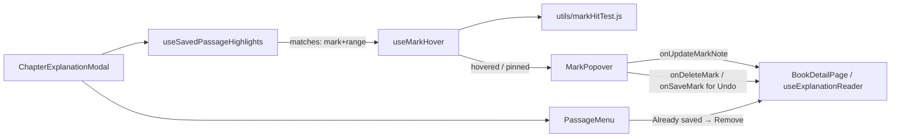

# 讲解高亮：悬停查看批注 + 移除高亮

状态：已实现（决策均采用 §8 的默认建议）
范围：仅前端（`frontend/`）。后端接口已具备（`PATCH /api/marks/{id}`、`DELETE /api/marks/{id}`、`POST /api/chapters/{chapterId}/marks`），数据库不改，不新增 npm 依赖

---

## 1. 问题

在 explanation 阅读器里打开 `🖍 Highlights: On` 后，已收藏的片段会像荧光笔一样常驻高亮，但高亮本身**只能看，不能操作**：

1. **不能在正文里直接删除高亮。** 想去掉一处高亮，只能关掉阅读器 → 打开书页的 “Saved Passages” 面板 → 找到那一条 → 删除。
2. **看不到批注。** 收藏时写的 note 只在 Saved Passages 面板里显示。阅读时看到一段高亮，不知道当时为什么标它。

期望的体验类似 PDF 阅读器里的标注：鼠标移到高亮上，弹出一个小卡片显示批注，卡片上有“删除高亮”“编辑批注”等按钮。

## 2. 现状与根因

| 位置 | 现状 | 带来的限制 |
| --- | --- | --- |
| [usePassageMarks.js](../../../frontend/src/components/explanation/usePassageMarks.js) 中 `useSavedPassageHighlights` | 用 CSS Custom Highlight API 绘制：`findAnchorRanges(root, marks)` 得到一组 `Range`，全部塞进**一个** `Highlight` 注册为 `mark-saved` | 1）高亮**不是 DOM 元素**，没有 `mouseenter` / `click` 事件可监听；2）返回的 ranges 已丢失与 mark id 的对应关系，无法知道鼠标下是哪一条 |
| [explanationAnchor.js](../../../frontend/src/utils/explanationAnchor.js) 中 `findAnchorRanges` | `anchors.map(a => locate(index, a).range).filter(Boolean)` | 同上，只返回 range，不返回 mark |
| [ChapterExplanationModal.jsx](../../../frontend/src/components/ChapterExplanationModal.jsx) | 只接收 `onSaveMark`、`onDeleteMark`，没有 `onUpdateMarkNote` | 阅读器内无法改批注 |
| [PassageMenu.jsx](../../../frontend/src/components/explanation/PassageMenu.jsx) | 选中的文字恰好是已收藏片段时只显示 `✓ Already saved` | 选中高亮也没法删 |
| `::highlight()` 伪元素 | 只支持 `background-color`、`color`、`text-decoration` 等少数属性，不支持 `cursor` | 无法只靠 CSS 做悬停效果 |

> 结论：**不改变“运行时绘制、不改 DOM、不写回 content”的原则**（见 [explanation-marks/design.md](../../explanation-marks/design.md) §3.1），改为在脚本里做“鼠标坐标 → 哪条高亮”的命中检测。

## 3. 方案概览

1. **保留 mark ↔ range 的对应关系**：`explanationAnchor.js` 新增 `findAnchorMatches(root, anchors)`，返回 `[{ mark, range }]`。
2. **命中检测**：新 hook `useMarkHover` 监听正文容器的 `pointermove`，用每个 range 的 `getClientRects()` 判断鼠标落在哪条高亮上（纯函数放 `utils/markHitTest.js`，可单测）。
3. **悬停反馈**：被悬停的那一条额外注册一个 `mark-hover` 高亮（颜色更深 + 下划线），让用户知道“这一整段是一条标注”。
4. **批注卡片 `MarkPopover`**：悬停片刻后在该行附近弹出，显示批注、日期，以及 `✎ Edit note`、`🗑 Remove` 按钮；点击高亮可“钉住”卡片。
5. **移除 + 撤销**：点 `🗑 Remove` 立即删除，原位置显示 `Highlight removed · Undo`（与现有 “Passage saved · Undo” 一致）；撤销即按原锚点和批注重新创建。
6. **选区菜单补一个删除入口**：选中的文字恰好是已收藏片段时，`✓ Already saved` 旁加 `🗑 Remove`。



## 4. 交互设计

### 4.1 生效条件

以下条件**全部**满足时才启用悬停/点击：

- 阅读模式（非编辑模式）；
- `prefs.showHighlights === true`（Highlights: On）；
- 浏览器支持 Custom Highlight API（`highlightsSupported()`）；
- 当前**没有**进行中的文字选区（`passages.selection == null`），也没有显示中的 “Passage saved · Undo” 提示。选区菜单优先，二者互斥。

Highlights 关闭时，行为与现在完全一致。

### 4.2 悬停（鼠标）

| 阶段 | 行为 |
| --- | --- |
| 鼠标进入某条高亮 | 立即给这一条加 `mark-hover` 高亮（整条变深 + 下划线，跨行也整条变）。 |
| 停留 ≥ 300ms | 弹出 `MarkPopover`。在不同高亮之间快速划过时不弹，避免闪烁。 |
| 鼠标移出高亮 | 启动 250ms 关闭计时；期间进入卡片则取消关闭，且鼠标停留在卡片上时不会再启动关闭计时（见 §10.1）。 |
| 鼠标移出卡片 | 同样 250ms 后关闭（编辑批注中除外，见 4.4）。 |
| 开始拖选文字 / 滚动正文 | 立即关闭未钉住的卡片；钉住的卡片随文字滚动（同 `useFloatingMenu`），滚出可视区时隐藏。 |

鼠标在高亮上时，正文容器加 class `is-over-mark`，光标保持 `text`（不改成 `pointer`，避免误导用户以为不能选中文字）。

### 4.3 点击 = 钉住（也是触屏的入口）

- 在高亮上**单击**（`pointerup` 时选区为空、位移 < 4px，且点击目标不在 `<a>` 内）→ 立即弹出卡片并**钉住**：鼠标离开也不关。
- 关闭钉住的卡片：点卡片外任意处、按 `Esc`、点卡片右上角 `×`、切到编辑模式、关闭 Highlights、关闭阅读器。
- `Esc` 只关卡片，不关阅读器（与全屏模式 Esc 的处理方式一致：capture 阶段 `stopPropagation`）。
- 触屏（`pointerType === 'touch'`）没有 hover，只走点击钉住这条路径。
- 高亮内的链接（如截图中的“刘邦”“项羽”）点击后仍正常跳转，不钉卡片；悬停在链接上仍会弹卡片。

### 4.4 批注卡片 `MarkPopover`

```
┌──────────────────────────────────────┐
│ 📝 Note                          ×   │  ← × 仅钉住时显示
│ 刘邦能约束欲望，项羽只顾眼前——        │  ← note，保留换行，最多约 8 行，超出滚动
│ 对照第 5 章“约法三章”。               │
│ ──────────────────────────────────── │
│ Saved 2026-11-03     ✎ Edit  🗑 Remove │
└──────────────────────────────────────┘
```

- **无批注时**：正文区显示灰色 `No note`，按钮显示 `✎ Add note`。
- **位置**：锚定在**鼠标所在的那一行矩形**（多行高亮不跳到第一行），优先放在该行上方，空间不够放下方；水平方向夹在正文容器内。实现上复用/抽取 [useFloatingMenu.js](../../../frontend/src/components/explanation/useFloatingMenu.js) 的定位逻辑，入参从 `range` 扩展为“一个 rect 的提供函数”。
- **宽度**：`max-width: 360px`，`z-index` 与 `.mark-menu` 相同（110）。
- **编辑批注**（`✎ Edit` / `✎ Add note`）：
  - 卡片自动转为钉住状态，正文区变为 `<textarea>`（`maxLength=1000`，与收藏时一致），按钮变为 `Save` / `Cancel`。
  - `Ctrl/⌘+Enter` 保存；`Esc` 取消编辑（第二次 Esc 才关卡片）。
  - 保存调用 `onUpdateMarkNote(id, note.trim())`；保存中按钮显示 `Saving…`；失败在卡片内显示 `Could not save the note. Try again.`，保留草稿。
  - 编辑中鼠标离开、滚动都不关闭卡片。
- **移除**（`🗑 Remove`）：
  1. 立即调用 `onDeleteMark(id)`；按钮显示 `Removing…`，防重复点击。
  2. 成功 → 卡片关闭，高亮消失，在原位置显示状态条 `✓ Highlight removed · Undo`（复用 `.mark-menu` 样式），6 秒后或用户点击其他地方后消失（与现有 `savedNotice` 相同的规则）。
  3. `Undo` → 用被删 mark 的 `{ quote, prefix, suffix, startOffset, endOffset, note }` 调 `onSaveMark` 重新创建。重新创建的是**新 id、新 createdAt**，内容与位置不变。
  4. 删除失败 → 卡片内显示 `Could not remove. Try again.`，卡片保持打开。撤销失败 → 状态条内显示 `Could not restore.`。
  - 不弹二次确认框：有 Undo 兜底，操作更顺手（见 §8 待确认 #1）。

### 4.5 重叠的高亮

两条收藏片段可能重叠（例如先标了一句，又标了包含它的整段）。鼠标位于重叠区域时，取**最短**的那条（最具体的那条），悬停效果和卡片都只针对它。其余那条在它不重叠的部分照常可以悬停。

### 4.6 选区菜单的删除入口

[PassageMenu.jsx](../../../frontend/src/components/explanation/PassageMenu.jsx) 中，`duplicate` 存在时（选中的文字与某条已收藏片段的 `startOffset/endOffset` 完全相同）：

```
✓ Already saved   🗑 Remove
```

点击后流程同 §4.4 的“移除”（删除 → `Highlight removed · Undo`）。这满足“选中高亮区域并删除”的直接诉求；选区只是部分覆盖高亮时不提供删除（避免误删），用悬停卡片即可。

### 4.7 键盘与无障碍

- Custom Highlight 无法获得焦点，键盘用户继续使用 Saved Passages 面板（已有编辑/删除）。
- 卡片为 `role="dialog"`、`aria-label="Saved passage note"`；钉住时焦点移入卡片的第一个按钮，关闭后焦点回到正文容器。
- 悬停弹出（未钉住）的卡片不抢焦点。

## 5. 技术设计

### 5.1 `utils/explanationAnchor.js`

新增（`findAnchorRanges` 保留，内部改为调用新函数，避免两套逻辑）：

```js
// Locates many passages against a single text index. Returns { mark, range }
// for the ones that could still be found, in input order.
export function findAnchorMatches(rootEl, anchors) { ... }
```

### 5.2 `utils/markHitTest.js`（新，纯函数）

```js
// matches: [{ mark, rects: DOMRect-like[] }]，rects 为相对正文容器的坐标
// 返回命中的 { mark, rect }（重叠时取 quote 最短的），未命中返回 null
export function hitTestMarks(matches, x, y, slop = 1) { ... }
```

- 判断 `rect.left - slop <= x <= rect.right + slop && rect.top <= y <= rect.bottom`。
- 跳过 `width === 0` 的空矩形（换行处 `getClientRects()` 会产生）。
- 不依赖 DOM，可在 jsdom 下直接单测。

### 5.3 `useSavedPassageHighlights` 改动

- 改用 `findAnchorMatches`，`CSS.highlights.set('mark-saved', new Highlight(...matches.map(m => m.range)))` 不变。
- **返回** `matches`（存 state 或 ref，供 `useMarkHover` 使用）。依赖项不变（`editing, showHighlights, explanation, savedKey`）。

### 5.4 `useMarkHover`（新，`components/explanation/useMarkHover.js`）

```js
export function useMarkHover({ contentRef, bodyRef, matches, enabled }) {
  // returns { hovered, pinned, pin, close, popoverRef, onPopoverEnter, onPopoverLeave }
  // hovered = { mark, range, rect } | null
}
```

要点：

- **矩形缓存**：把每个 range 的 `getClientRects()` 换算成**相对 `contentRef` 左上角**的坐标后缓存。正文在 `bodyRef` 内滚动时二者一起移动，缓存无需失效；只在以下情况重建（标记 dirty，下一次 pointermove 时懒重建）：`matches` 变化、字号变化、`ResizeObserver(contentRef)` 触发（窗口缩放、全屏、图片侧栏拖动都会改变正文宽度）。
- **pointermove** 用 `requestAnimationFrame` 节流；把 `clientX/Y` 换算成相对 `contentRef` 的坐标后调 `hitTestMarks`。
- 鼠标按下期间（`e.buttons !== 0`，即拖选中）不做命中检测并关闭未钉住的卡片。
- 悬停的那条：`CSS.highlights.set('mark-hover', new Highlight(range))`，`priority = 1`（高于 `mark-saved`，低于 `mark-flash` 的 2），离开时删除。
- `enabled` 为 false（见 §4.1）时清空所有状态并移除 `mark-hover`。
- `matches` 刷新后若当前悬停/钉住的 mark 已不存在（被删了）→ 关闭。
- 计时器：显示延迟 300ms、关闭延迟 250ms，常量放在文件顶部。

### 5.5 `MarkPopover.jsx`（新，`components/explanation/`）

- props：`{ popoverRef, mark, pinned, onClose, onUpdateNote, onRemove, onPointerEnter, onPointerLeave }`。
- 内部 state：`editing`、`draft`、`busy`（`'saving' | 'removing' | null`）、`error`。
- `onMouseDown` 处理与 `PassageMenu` 相同：非输入框时 `preventDefault`，避免点击按钮清掉选区/触发 selectionchange。
- 日期用现有 `isoDay(mark.createdAt)`（[dates.js](../../../frontend/src/utils/dates.js)）。

### 5.6 移除与撤销状态

放到 `usePassageMarks` 里，与 `savedNotice` 并列，复用同一套“6 秒 / 点别处即消失”的逻辑：

```js
const [removedNotice, setRemovedNotice] = useState(null); // { mark, range }
const remove = async (mark, range) => { await onDeleteMark(mark.id); setRemovedNotice({ mark, range }); };
const undoRemove = async () => { /* onSaveMark({ quote, prefix, suffix, startOffset, endOffset, note }) */ };
```

- `PassageMenu` 增加第三种显示形态：`removedNotice` 存在时显示 `✓ Highlight removed · Undo`。
- `useFloatingMenu` 的 `range` 取值顺序：`selection.range ?? savedNotice.range ?? removedNotice.range`。
- 注意：被删 mark 的 range 在高亮重建后仍然有效（DOM 未变），可以继续用来定位状态条。

### 5.7 接线

| 文件 | 改动 |
| --- | --- |
| [ChapterExplanationModal.jsx](../../../frontend/src/components/ChapterExplanationModal.jsx) | 新 prop `onUpdateMarkNote`；拿到 `useSavedPassageHighlights` 返回的 `matches` 传给 `useMarkHover`；渲染 `MarkPopover`；`enabled` 按 §4.1 计算；进入编辑模式时一并关闭卡片 |
| [BookDetailPage.jsx](../../../frontend/src/pages/BookDetailPage.jsx) | 给阅读器加 `onUpdateMarkNote={reader.updateMarkNote}`（`useExplanationReader` 已有该方法，无需改） |
| [PassageMenu.jsx](../../../frontend/src/components/explanation/PassageMenu.jsx) | `Already saved` 旁加 `🗑 Remove`；新增 removed 状态条 |
| [usePassageMarks.js](../../../frontend/src/components/explanation/usePassageMarks.js) | `useSavedPassageHighlights` 返回 matches；新增 `removedNotice` / `remove` / `undoRemove` |
| [useFloatingMenu.js](../../../frontend/src/components/explanation/useFloatingMenu.js) | 抽出可复用的定位函数，支持传入单个 rect（卡片锚定到鼠标所在行） |
| [explanationAnchor.js](../../../frontend/src/utils/explanationAnchor.js) | 新增 `findAnchorMatches` |
| `utils/markHitTest.js`（新） | `hitTestMarks` |
| `components/explanation/useMarkHover.js`（新） | 悬停/钉住状态、命中检测、`mark-hover` 高亮 |
| `components/explanation/MarkPopover.jsx`（新） | 批注卡片 |
| [passages.css](../../../frontend/src/styles/passages.css) | `::highlight(mark-hover)`、`.mark-popover*` 样式 |

### 5.8 样式

```css
::highlight(mark-hover) {
  background-color: color-mix(in srgb, var(--accent) 85%, transparent);
  text-decoration: underline 2px color-mix(in srgb, var(--accent) 100%, black 20%);
}
.mark-popover { position: fixed; z-index: 110; max-width: 360px; /* 与 .mark-menu 同风格：卡片背景、圆角、阴影 */ }
.mark-popover-note { white-space: pre-wrap; max-height: 10em; overflow-y: auto; }
.mark-popover-note.is-empty { color: var(--text-secondary); font-style: italic; }
```

颜色变量以 `passages.css` 现有写法为准，明暗主题都要检查对比度。

## 6. 边界情况

| 场景 | 处理 |
| --- | --- |
| 高亮在当前讲解里已找不到（讲解被改过） | 没有 range，就不会被命中；不受影响 |
| 卡片打开时讲解被保存/重新渲染 | `matches` 重建；若该 mark 仍在，卡片跟随新 range；若不在则关闭 |
| 卡片打开时从 Saved Passages 面板删除了同一条 | `marks` 更新 → `matches` 不含该 mark → 关闭卡片 |
| 正在选文字时经过高亮 | 不弹卡片（`buttons !== 0` / `selection` 存在） |
| 选区菜单与卡片同时满足显示条件 | 选区菜单优先，卡片关闭 |
| 删除后马上又删另一条 | 新的 `removedNotice` 覆盖旧的；旧的不再可撤销（与 `savedNotice` 一致） |
| 正文滚动 | 钉住的卡片跟随所在行；该行滚出可视区时卡片隐藏、滚回来再显示 |
| 字号 A−/A+、全屏切换、图片侧栏拖动 | `ResizeObserver` / 字号依赖使矩形缓存失效，下次移动时重建 |
| 极长片段（跨几十行） | 只缓存矩形，命中检测为 O(总矩形数)，几百个矩形以内无压力；如需优化再按 top 排序二分 |
| 不支持 Custom Highlight 的浏览器 | Highlights 按钮本就不显示，本功能整体不启用 |

## 7. 测试计划

**单元测试（Vitest，jsdom）**

- `markHitTest.test.js`：命中单行/多行；空矩形跳过；重叠取最短；边界 slop；未命中返回 null。
- `explanationAnchor.test.js`：`findAnchorMatches` 返回 mark 与 range 对应且过滤未找到的；`findAnchorRanges` 行为不变。

**组件测试（`ChapterExplanationModal.test.jsx` 的 saved passages 分组，沿用 `supportHighlights()` 桩）**

jsdom 没有布局，测试中 stub `Range.prototype.getClientRects` / `Element.prototype.getBoundingClientRect` 返回固定矩形，再派发 `pointermove`，使用 fake timers 推进 300ms：

1. 悬停到高亮上 → 出现卡片，显示 note；无 note 时显示 `No note`。
2. Highlights Off 或编辑模式 → 悬停不出现卡片。
3. 点击高亮 → 卡片钉住，移开鼠标仍在；`Esc` 关闭卡片但阅读器不关。
4. `✎ Edit` → 修改 → Save：调用 `onUpdateMarkNote(id, '新批注')`；失败时显示错误并保留草稿。
5. `🗑 Remove`：调用 `onDeleteMark(id)`，出现 `Highlight removed`；`Undo` 用原锚点和 note 调 `onSaveMark`。
6. 选中与已收藏片段相同的文字 → `Already saved` 旁的 `🗑 Remove` 可删除。
7. 有选区时悬停高亮不弹卡片。

**手动验收（Chrome / Edge）**

- 截图中的场景：悬停“两人的选择形成鲜明对照：”、跨行的列表项高亮，卡片出现在鼠标所在行附近；高亮内的“刘邦”链接仍可点击跳转。
- 全屏、打开图片侧栏并拖动分隔条、调整字号后，悬停位置仍准确。
- 明/暗主题下 `mark-hover` 与卡片的可读性。
- `npm run lint`、`npm test` 通过。

## 8. 待确认的决策

| # | 问题 | 建议（本文默认） | 备选 |
| --- | --- | --- | --- |
| 1 | 删除是否二次确认 | 不确认，删除后给 6 秒 Undo | 卡片内二段式确认（`Remove?` → `Yes, remove`） |
| 2 | 卡片弹出方式 | 悬停 300ms 弹出 + 点击钉住 | 只在点击时弹出（更“安静”，但不像 PDF 悬停预览） |
| 3 | 卡片里是否显示片段原文 `quote` | 不显示（原文就在旁边高亮着） | 显示前 60 字作标题 |
| 4 | 重叠高亮 | 取最短的一条 | 卡片里列出所有重叠的条目，可切换 |
| 5 | 选区菜单 `Already saved` 旁加 `🗑 Remove` | 加 | 不加，只走悬停卡片 |
| 6 | 无批注的高亮悬停时是否也弹卡片 | 弹（显示 `No note` + `Add note` + `Remove`） | 只悬停变色，点击才弹 |

## 9. 不在本次范围

- 高亮颜色 / 分类 / 标签。
- 调整已有高亮的范围（拖动边界扩大缩小）。
- 部分选中高亮后只删除其中一段（拆分标注）。
- 键盘在正文高亮之间跳转（Tab 到高亮）。
- 后端与数据库改动。

## 10. 实现后的问题记录

### 10.1 鼠标已移到卡片上，卡片仍然消失

**现象**：悬停弹出批注卡片后，鼠标从高亮移向卡片准备点 `Edit` / `Remove`，250ms 内就已进入卡片，卡片却照样消失。

**根因**：事件顺序竞态。鼠标从正文移进卡片时，浏览器依次触发正文的 `pointerout` → `pointerleave`，再触发卡片的 `pointerover` → `pointerenter`。卡片用 React 的 `onPointerEnter`，React 在处理 `pointerout` 时就合成了 enter，于是 `onPopoverEnter` 先取消了关闭计时；而正文上手动注册的原生 `pointerleave`（`useMarkHover` 的 `onLeave`）随后才触发，调用 `hover(null)` → `scheduleHide()` **重新启动**了关闭计时。此时鼠标已在卡片上，再没有事件能取消它，250ms 后卡片被关闭。

**修复**（`useMarkHover.js`，不改 `HIDE_DELAY_MS`）：
- 新增 `overPopoverRef`：`onPopoverEnter` 置 true，`onPopoverLeave` 置 false；卡片关闭、功能被禁用时重置。
- `scheduleHide` 在鼠标位于卡片上时不安排关闭，计时器到点时也再检查一次。无论 enter / leave 事件先后，“鼠标在卡片上就不关闭”都成立。

**测试**：`ChapterExplanationModal.test.jsx` 新增 “stays open once the pointer is on the card, however the events interleave”，按“卡片 enter 先到、正文 leave 后到”的顺序派发事件，等待超过 250ms 断言卡片仍在，鼠标离开卡片后才关闭。去掉修复后该用例失败。

### 10.2 鼠标不在高亮文字上，卡片也会弹出

**现象**：一条高亮跨了多个块（例如从标题一直标到后面的列表）时，鼠标停在短列表项右侧的空白处、列表项之间的行距里，卡片照样弹出；而且卡片被锚在整块的位置上，离鼠标所在的那一行很远，盖住了中间的几行。

**根因**：命中检测（`useMarkHover` 的 `hitAt`）用 `range.getClientRects()` 缓存每条高亮的矩形。Chrome 返回的不只是文字行：range 完全包住的块级元素（`<p>`、`<ul>`、`<li>` …）也会返回**整块的边框盒**（全宽，包含空白和行距）。而 Custom Highlight API 只绘制文字，所以“看得见的高亮”和“可命中的区域”不一致。实测（宽 600px 的容器，跨 `<p>` + `<ul>` + `<p>` 的 range）：

```
8-608  w=600 y=48-67    ← 整段 <p>，文字只有 61px 宽
8-608  w=600 y=83-139   ← 整个 <ul>，含右侧空白和行距
48-98  w=50  y=83-101   ← 真正的文字行
```

**修复**：
- `utils/explanationAnchor.js` 新增 `textClientRects(range)`：遍历 range 内（`range.intersectsNode`）的文本节点，为每个文本节点建子 range（首尾节点按 range 的 `startOffset` / `endOffset` 裁剪），只收集这些子 range 的 `getClientRects()`，块元素的边框盒不会进入结果。
- `useMarkHover.js` 的 `hitAt` 改用 `textClientRects(range)` 构建矩形缓存。缓存失效（`matches` 变化、`ResizeObserver`）、延迟、钉住等其他逻辑不变。
- 卡片的锚点现在是鼠标所在那一行的文字矩形，位置随之变准。
- 选区菜单用的 `useFloatingMenu` 取 `rects[0]`，不受影响，未改动。

**测试**：
- `explanationAnchor.test.js` 新增 `textClientRects` 用例：模拟 Chrome 的行为（文字矩形 + 全宽块矩形），断言只返回文字节点的矩形、首尾按 offset 裁剪；以及 range 在单个文本节点内的情况。
- `ChapterExplanationModal.test.jsx` 新增 “ignores the blank space of blocks a passage spans”：一条高亮跨 `<p>` / `<ul>` / `<p>`，鼠标在 `<ul>` 的空白处不弹卡片，在文字上才弹。去掉修复后该用例失败。
