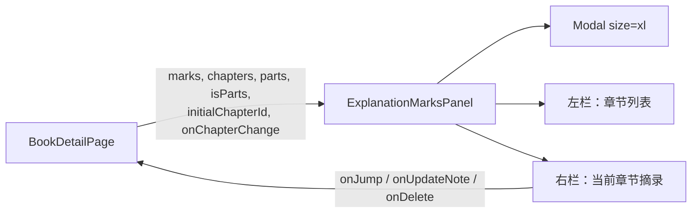

# Saved Passages：关闭按钮随内容滚走 + 按章节分栏阅读

状态：设计中（待评审）
范围：仅前端（`frontend/`）。后端接口、数据库都不改，不新增 npm 依赖

---

## 1. 问题

书页 “Saved Passages” 面板（[ExplanationMarksPanel.jsx](../../../frontend/src/components/ExplanationMarksPanel.jsx)）目前有两个问题：

1. **Bug：往下滚动后 × 不见了。** 滚到列表下方后，右上角的 × 跟着内容滚出可视区，要关闭面板必须先滚回顶部（或按 Esc / 点遮罩，但用户不一定知道）。
2. **布局：所有章节的摘录从上到下排成一长列。** 摘录一多（截图里 31 条），想看某一章的摘录只能一路往下滚找章节标题；也没有全局视图，不知道一共有哪些章节有摘录、各有几条。

期望：左侧列出有摘录的章节，点选后右侧只显示该章节的摘录。

## 2. 现状与根因

### 2.1 × 滚走（所有 md / lg 弹窗都有）

| 位置 | 现状 |
| --- | --- |
| [modal.css](../../../frontend/src/styles/modal.css) `.modal` | `.modal` **本身**就是滚动容器：`max-height: 92vh; overflow-y: auto` |
| [modal.css](../../../frontend/src/styles/modal.css) `.modal-close` | `position: absolute; top; right`，相对 `.modal` 定位 |
| [Modal.jsx](../../../frontend/src/components/Modal.jsx) | `×`、标题、`children` 都是 `.modal` 的直接子元素 |

绝对定位元素在滚动容器内部会**随滚动内容一起移动**，所以 × 和标题都滚走了。这是通用组件的问题，`size="md"`（默认）和 `size="lg"` 的弹窗都会遇到，只是 Saved Passages 内容最长、最明显。

`size="xl"`（[ChapterExplanationModal.jsx](../../../frontend/src/components/ChapterExplanationModal.jsx)、[ReviewReaderModal.jsx](../../../frontend/src/components/ReviewReaderModal.jsx)）已经是 `overflow: hidden` + 内部子元素各自滚动，不受影响。

### 2.2 长列表布局

| 位置 | 现状 |
| --- | --- |
| [ExplanationMarksPanel.jsx](../../../frontend/src/components/ExplanationMarksPanel.jsx) `groups` | 按 `mark.chapterId` 分组，组的顺序就是接口返回顺序 |
| [ExplanationMarkRepository.java](../../../backend/src/main/java/com/bookscoreideas/repository/ExplanationMarkRepository.java) 书级查询 | `ORDER BY c.orderIndex, m.startOffset, m.id` —— 只按章节 `orderIndex` 排，**没有考虑 Part 的顺序**。若章节被拖到另一个 Part、或 `orderIndex` 是 Part 内序号，不同 Part 的章节会交错 |
| [explanationExport.js](../../../frontend/src/pages/bookDetail/explanationExport.js) `explanationExportChapters` | 已有一份“按书中顺序排章节”的前端逻辑（Part 顺序 → Part 内章节顺序 → 未分组章节） |

## 3. 方案概览

1. **修通用 Modal（全局）**：`md` / `lg` 弹窗改为“头部固定 + 内容区滚动”。× 和标题永远可见，所有普通弹窗一起受益。
2. **Saved Passages 改为左右两栏**：改用 `size="xl"` 的自管布局；左栏是**有摘录的章节**列表（按书中顺序，带数量），右栏只显示选中章节的摘录，两栏各自滚动。
3. **章节顺序由前端决定**：复用 `explanationExportChapters` 的排序，与书页上的章节顺序一致；章节内仍按原文位置（`startOffset`）排列。
4. **记住上次选中的章节**：Jump to 进阅读器、读完再打开面板，回到原来的章节。



## 4. 修复 1：通用 Modal 头部固定

### 4.1 结构

`Modal.jsx` 对 `md` / `lg` 把 `children` 包进一个新的滚动容器 `.modal-body`；`xl` 保持现状（不包，调用方自管布局）。

```jsx
<div className={`modal modal--${size} ...`}>
  <button className="modal-close">×</button>
  {title && <h3 className="modal-title">{title}</h3>}
  {size === 'xl' ? children : <div className="modal-body">{children}</div>}
</div>
```

### 4.2 样式

```css
.modal--md,
.modal--lg {
  display: flex;
  flex-direction: column;
  overflow: hidden;            /* 不再由 .modal 滚动 */
}
.modal-title { flex: none; }
.modal-body {
  flex: 1 1 auto;
  min-height: 0;               /* 允许在 flex 中收缩，才会出现滚动条 */
  overflow-y: auto;
  /* 滚动条贴着弹窗右边缘、底部留白跟随内容滚动，同时不裁掉输入框的 focus 外框 */
  margin: 0 -2rem -2rem;
  padding: 0 2rem 2rem;
}
```

- 标题与 × 在内容区之外，不再随滚动移动。
- 弹窗高度规则不变（`max-height: 92vh`），短内容的弹窗外观完全不变。
- 已确认仓库里没有依赖 “`.modal` 是滚动容器” 或 `.modal > ...` 结构的 CSS / 测试；表单弹窗的 `.modal-actions` 进入 `.modal-body`，长表单时随内容滚动（与现在一致）。

### 4.3 影响面

使用 `md` / `lg` 的弹窗：BookForm、ChapterForm、PartForm、IdeaForm、ExcerptForm、JsonImportModal、ConfirmDialog、LinkFixPrompt、BookMigrationModal、ExplanationExportModal。实现后需逐个打开确认外观、滚动和自动聚焦正常（见 §8）。

> Saved Passages 改版后使用 `xl` 自管布局（§5），不依赖 `.modal-body`；但修复 1 独立成立，可单独先合入。

## 5. 改进 2：左右两栏布局

### 5.1 线框

```
┌──────────────────────────────────────────────────────────────────────┐
│ Saved Passages (31)                                               ×  │  ← 固定
├────────────────────────┬─────────────────────────────────────────────┤
│ ▌刘项之争：学习历史…  2 │ 刘项之争：学习历史和管理，是有捷径的  2 passages │  ← 右栏标题固定
│  胜利之后：隔层任命…  3 │ ─────────────────────────────────────────── │
│  第三章 ……            5 │ ┃ 两人的选择形成鲜明对照：刘邦虽然……        │
│  第七章 ……            1 │ Nov 3, 8:18 AM   [Jump to][Add note][Delete] │
│  ……                     │ ┄┄┄┄┄┄┄┄┄┄┄┄┄┄┄┄┄┄┄┄┄┄┄┄┄┄┄┄┄┄┄┄┄┄┄┄┄┄┄┄ │
│  （左栏独立滚动）        │ ┃ 4. 制定战略后还要保持战略笃定……            │
│                        │ Nov 3, 8:22 AM   [Jump to][Add note][Delete] │
│                        │  （右栏独立滚动）                             │
└────────────────────────┴─────────────────────────────────────────────┘
```

### 5.2 弹窗与布局

- `Modal size="xl"`，加 class `marks-modal`：宽度沿用 xl（`max-width: 1100px; width: 95%`），**高度固定** `height: min(85vh, 760px)`，切换章节时弹窗不跳动。
- 主体 `.marks-layout`：`display: grid; grid-template-columns: 260px 1fr; flex: 1; min-height: 0`。
- 左栏 `.marks-sidebar`、右栏 `.marks-content` 各自 `overflow-y: auto`。右栏的章节标题行 `position: sticky; top: 0`。
- 错误提示 `.marks-error` 放在右栏顶部（标题行下方）。

### 5.3 左栏：章节列表

| 规则 | 说明 |
| --- | --- |
| 显示哪些章节 | **只显示有摘录的章节**，每项右侧显示条数 |
| 顺序 | 书中顺序：复用 `explanationExportChapters(chapters, parts, isParts)` 得到的章节顺序，再过滤出有摘录的章节 |
| Part 分组 | **不分组**，扁平列表（Part 只影响排序）。章节标题本身通常已足够区分 |
| “全部”入口 | **不提供**。右栏始终是单个章节；以后若做跨章节搜索再考虑 |
| 章节标题 | 最多两行，超出省略（`-webkit-line-clamp: 2`），`title` 属性显示全文 |
| 选中态 | 左侧色条 + 背景高亮；`aria-current="true"` |
| 兜底 | 若某条摘录的 `chapterId` 不在 `chapters` 里（理论上不会出现），追加到列表末尾，标题用 `mark.chapterTitle`，避免摘录“消失” |

实现上是 `<nav aria-label="Chapters">` 里的一组 `<button>`，Tab 可达，Enter / Space 选择。

### 5.4 右栏：当前章节摘录

- 顶部：章节标题 + “N passages”。
- 下面是该章节的摘录列表，**单条摘录的样式和操作保持现状**：引用块、Show more / Show less、批注、时间、`⚠ Position may have changed`、Jump to / Add note / Edit note / Delete、删除确认弹窗。
- 章节内顺序保持接口返回的 `startOffset` 顺序（即原文顺序）。
- 切换章节时：右栏滚动回顶部；若正在编辑批注，**取消编辑**（草稿丢弃，与点 Cancel 一致）。

### 5.5 默认选中章节

打开面板时按以下顺序决定选中哪一章：

1. **上次在面板里选中的章节**（仍有摘录时）。保存在 `BookDetailPage` 的 state 中，在当前书页生命周期内有效，离开书页即清空，不写 localStorage。
2. 否则选**书中顺序的第一个**有摘录的章节。

打开时左栏把选中项 `scrollIntoView({ block: 'nearest' })`，避免长列表中选中项不可见。

典型场景：在第 5 章点 Jump to → 面板关闭、阅读器打开 → 读完关掉阅读器 → 再打开 Saved Passages，仍停在第 5 章。

### 5.6 删除导致章节变空

删除某章最后一条摘录后，该章从左栏消失，选中项自动移到**原位置的下一章**；若它是最后一章，则移到上一章；若已没有任何摘录，显示现有的空状态（📑 No saved passages yet.）。

在阅读器里新增/删除摘录后再打开面板，列表按最新 `marks` 重新计算，无需额外处理。

### 5.7 窄屏降级

本次不做专门的移动端设计，只保证不坏：宽度 < 640px 时 `.marks-layout` 改为上下排列，左栏变成顶部区域（`max-height: 30vh`，独立滚动），右栏在下。

## 6. 组件与接口改动

### 6.1 `ExplanationMarksPanel` props

```diff
 <ExplanationMarksPanel
   marks={marks}
+  chapters={chapters}
+  parts={parts}
+  isParts={isParts}
+  initialChapterId={marksChapterId}
+  onChapterChange={setMarksChapterId}
   staleIds={reader.staleMarkIds}
   onJump={jumpToMark}
   onUpdateNote={reader.updateMarkNote}
   onDelete={reader.deleteMark}
   onClose={() => setShowMarks(false)}
 />
```

- 面板内部用 `useState(initialChapterId)` 持有当前章节，每次切换调用 `onChapterChange`；`BookDetailPage` 新增 `const [marksChapterId, setMarksChapterId] = useState(null)`。
- “有效选中章节”在渲染时计算：当前 id 不在有摘录的章节里时，按 §5.5 / §5.6 规则回退，不需要额外的 effect。§5.6 的“下一章”需要记住上一次渲染时的章节顺序（`useRef`）以找到原位置。

### 6.2 拆分（建议）

[ExplanationMarksPanel.jsx](../../../frontend/src/components/ExplanationMarksPanel.jsx) 当前把单条摘录的渲染和编辑逻辑都写在 map 里，改版后文件会变长。建议：

- 新建 `components/marks/MarkItem.jsx`：单条摘录（引用、展开、批注编辑、meta、按钮），逻辑原样搬过去。
- `ExplanationMarksPanel.jsx` 只负责：分章节、左栏、选中状态、错误提示、删除确认。
- 排序 / 回退逻辑写成纯函数（如 `marksByChapter(marks, chapters, parts, isParts)`、`fallbackChapter(prevOrder, nextOrder, id)`），便于单测。

### 6.3 样式

- [modal.css](../../../frontend/src/styles/modal.css)：§4.2 的 `.modal-body` 等。
- [passages.css](../../../frontend/src/styles/passages.css)：新增 `.marks-modal`、`.marks-layout`、`.marks-sidebar`、`.marks-chapter-btn`（含 `.is-active`、计数徽标）、`.marks-content`、`.marks-content-header`；现有 `.marks-item` 等保持不变；删除不再使用的 `.marks-group-title`。
- 颜色沿用现有变量（`--accent`、`--border`、`--bg-hover`、`--text-secondary`），不引入新色值。

## 7. 不变的行为

- Esc 关闭面板；编辑批注中 / 删除确认弹出时 Esc 不关面板（现有 `closeOnEsc` 逻辑）。
- 点遮罩关闭面板。
- Jump to：关闭面板并在阅读器中定位到该摘录。
- 删除仍需确认；批注最长 1000 字；长摘录 280 字折叠。
- 后端接口与返回顺序不变。

## 8. 测试与验证

**单元 / 组件测试（Vitest + Testing Library）**

- `Modal`：`md` / `lg` 的 children 在 `.modal-body` 内，`xl` 不包；× 与标题不在 `.modal-body` 内。
- `ExplanationMarksPanel`：
  - 左栏只列出有摘录的章节，顺序符合书中顺序（含有 Part 的用例），条数正确；
  - 默认选中：有 `initialChapterId` 时选中它；它已无摘录时回退到第一章；
  - 点击左栏切换右栏内容并调用 `onChapterChange`；
  - 删除某章最后一条后选中下一章 / 最后一章时选中上一章 / 全部删完显示空状态；
  - 切换章节会取消进行中的批注编辑；
  - 现有的 Jump / 批注 / 删除用例继续通过。
- [BookDetailPage.behavior.test.jsx](../../../frontend/src/pages/BookDetailPage.behavior.test.jsx)：Jump to 后重新打开面板，仍停在原章节。

**手工验证**

- 31 条摘录的书：右栏滚到底，× 始终可见；左右两栏各自滚动。
- 逐个打开 §4.3 列出的 md / lg 弹窗：外观无变化，长内容时标题与 × 固定，输入框自动聚焦正常，focus 外框不被裁切。
- 窗口宽度 < 640px：上下排列可用。

## 9. 未来可选改进（本次不做）

讨论中提到、暂不需要但值得记录的方向：

| 改进 | 说明 |
| --- | --- |
| 搜索 | 按摘录原文 / 批注关键字过滤，可跨章节，届时可配合“全部”入口 |
| 排序切换 | 章节内按原文位置 / 按收藏时间 |
| 复制 | 一键复制摘录（附章节名、书名） |
| 导出 | 当前章节或全部摘录导出为 Markdown |
| 删除改为 Undo | 去掉确认弹窗，即时删除 + “Passage deleted · Undo”（与阅读器内一致） |
| 多行批注 | 批注编辑从单行 input 改为 textarea |
| 键盘导航 | ↑ / ↓ 切换章节，快捷键 Jump |
| 轻量操作按钮 | 图标按钮或悬停显示，降低每条摘录下三个按钮的视觉噪音 |
| 移动端设计 | 左栏改为顶部下拉选择等专门的窄屏交互 |
| 失效摘录筛选 | 汇总显示 “Position may have changed” 的摘录，便于清理 |
| “阅读本章”入口 | 右栏标题旁直接打开该章节讲解（不定位到具体摘录） |
| 后端排序修正 | 书级 marks 查询按 Part 顺序 + 章节顺序排序（本次前端已自行排序，不依赖它） |

## 10. 决策记录

| # | 问题 | 决定 |
| --- | --- | --- |
| 1 | × 的修复范围 | 修通用 Modal，所有 md / lg 弹窗受益 |
| 2 | 左栏显示哪些章节 | 只显示有摘录的章节，带数量 |
| 3 | 是否按 Part 分组 | 不分组，扁平列表，Part 只用于排序 |
| 4 | 是否有“全部”入口 | 不提供 |
| 5 | 默认选中章节 | 上次选中（书页内记忆）→ 第一个有摘录的章节 |
| 6 | 其它改进 | 本次不做，记录在 §9 |
